<!-- ANSH SINGH · ONE DAY, 24 HOURS · every visual in /assets is a hand-drawn animated SVG; activity graphs redraw nightly via .github/workflows/night-shift.yml -->

  <a href="https://huggingface.co/spaces/Anshsactivity/rupeeguard-ai">
    
  </a>

  
  
  
  
  
  

 

<!-- ─────────────────────── CHOOSE YOUR PATH ─────────────────────── -->

<b>🧑‍💼 &nbsp;Recruiters: the 30-second version</b>

 

| Signal | Evidence |
|---|---|
| **Role fit** | SDE · ML Engineer · Backend (Python / Java / Node) |
| **Now** | ML Project Intern @ **IIIT Allahabad** (May 2026 –) |
| **Education** | B.E. ISE, **M.S. Ramaiah Institute of Technology** · CGPA **9.29** |
| **Algorithms** | **ICPC Asia West Regionalist 2026** (Rank 269, Asia West Amritapuri Regional) · LeetCode **Knight (2033, top 2.19%)** · CF **Specialist** · **1300+** problems |
| **Flagship** | [RupeeGuard AI](https://github.com/AnshSingh-2024/RupeeGuard-AI): CNN⊕ViT fusion, GradCAM, RAG reports, **99.21%** val. acc, **live** |
| **Community** | **Core member, CodeRIT**, the competitive coding club of MSRIT |
| **Open source** | **GSSoC 2026** contributor (GirlScript Summer of Code) |
| **Hackathons** | Flipkart GRiD 8.0 **Semi-Finalist** (1.65L+) · Fidelity India Hackathon **Top 12** (1700+ teams) |
| **Contact** | [LinkedIn](https://www.linkedin.com/in/ansh-singh6380/) · [Email](mailto:anshsactivity@gmail.com) |

<b>🎓 &nbsp;Batchmates: where to look first</b>

 

- 🔍 **Learning ML?** Read [RupeeGuard AI](https://github.com/AnshSingh-2024/RupeeGuard-AI): a full PyTorch → FastAPI → React → Docker pipeline in one repo.
- 📈 **Building full-stack?** [FinSocial](https://github.com/AnshSingh-2024/FinSocial) covers Postgres transactions, Redis and Socket.IO in practice.
- ☕ **Got the DBMS + Java project?** [Stock Portfolio Tracker](https://github.com/AnshSingh-2024/stock-market-portfolio-tracker) uses a clean DAO/MVC layout.
- 🧠 **Reading about LLMs?** The [Emergent Behaviors report](https://github.com/AnshSingh-2024/Technical-Report-Emergent-Behaviors-in-LLMs) is a quick primer.
- ⚔️ **Grinding DSA / ICPC?** Add me on [LeetCode](https://leetcode.com/u/Ansh_Singh5245/) and [Codeforces](https://codeforces.com/profile/Learn2SolveP).

<!-- ─────────── 09:00 AM · STAND-UP ─────────── -->


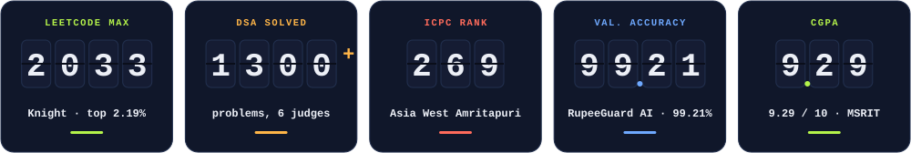

<!-- ─────────── 11:30 AM · DEEP WORK ─────────── -->

  <a href="https://github.com/AnshSingh-2024/RupeeGuard-AI"></a>

  <a href="https://github.com/AnshSingh-2024/FinSocial"></a>
  <a href="https://github.com/AnshSingh-2024/COMMIT.ENV"></a>

  <a href="https://github.com/AnshSingh-2024/Technical-Report-Emergent-Behaviors-in-LLMs"></a>
  <a href="https://github.com/AnshSingh-2024/stock-market-portfolio-tracker"></a>

  
    <a href="https://huggingface.co/spaces/Anshsactivity/rupeeguard-ai">RupeeGuard live demo</a> &nbsp;·&nbsp;
    <a href="https://fin-social-eight.vercel.app/">FinSocial live</a> &nbsp;·&nbsp;
    <a href="https://youtu.be/Z0-7T47D6Pg">HomeHarvest demo video</a>
  


<!-- ─────────── 02:00 PM · THE STACK ─────────── -->


<!-- ─────────── 05:00 PM · TROPHY CASE ─────────── -->


<!-- ─────────── 08:00 PM · CONTEST HOUR ─────────── -->


  

<!-- ─────────── 02:37 AM · NIGHT SHIFT ─────────── -->



  
  

<!-- ─────────── 06:00 AM · LOG OFF ─────────── -->

  <a href="https://www.linkedin.com/in/ansh-singh6380/"></a>

